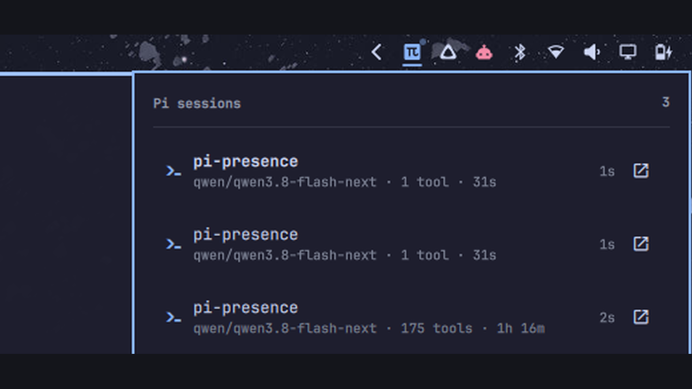

# pi.presence

One **π** on the right of the [Omarchy](https://omarchy.org) bar, in the tray drawer. Click it
and a panel drops down listing every running [pi](https://pi.dev) session — the
project, what it is doing right now (`executing bash`, `editing`, `asking a
question`, `waiting for you`), a thread of its recent bubbles, and a **Jump**
button that focuses that session's terminal.

The window border tells the story from across the room: it swells to a rotating
accent gradient while an agent works, goes solid urgent when one waits for you,
and returns to the theme baseline when everything is idle.



```
                    π 3                            in the tray drawer, right
        ┌────────────────────────────────────────────┐
        │ Pi sessions                              3   │
        │ ─────────────────────────────────────────── │
        │ 󰋗  Notes            asking a question   2s  [jump]
        │      ◦ asking a question
        │ 󰞷  Dotfiles         executing bash       1s  [jump]
        │      ◦ thinking
        │      ◦ editing · Panel.qml
        │      ◦ executing bash · omarchy plugin validate
        │      qwen3.8 · 12 tools · 50s
        │ 󰏿 idle · Dotfiles                   4s   [jump]
        └────────────────────────────────────────────┘
```

## Install

```bash
git clone <your-remote> ~/Work/pi-presence
cd ~/Work/pi-presence
./install.sh
```

`install.sh` copies the plugin into `~/.config/omarchy/plugins/pi-presence`,
validates it, puts the widget first in the bar's **tray drawer**, installs the pi
extension into `~/.pi/agent/extensions/`, and restarts the shell.

The plugin has two pieces, and both are needed: the QML plugin shows the state the
pi extension writes. Installing only the plugin gives an empty panel; installing
only the extension writes a file nobody reads.

| flag | effect |
| --- | --- |
| `--dry-run` | print what would happen, change nothing |
| `--no-restart` | install, leave the running shell alone |
| `--uninstall` | remove the plugin, its bar slot, and the extension |

Requires Omarchy (Quickshell + Hyprland) and `jq`.

Two things a symlink cannot do here, which is why there is a script:

* Omarchy's plugin validator rejects symlinks inside a plugin folder, so the
  plugin is copied.
* Quickshell has no config hot reload — without a shell restart the bar keeps the
  QML it loaded at boot.

`pi` picks up the extension on its **next start**, never in a running session.

## How it works

```
pi process A ─┐
pi process B ─┼─► ~/.cache/pi-presence/sessions.json ─► FileView ─► Panel.qml
pi process C ─┘        (registry, v2)                              └► Service.qml
```

* **The extension** (`extension/omarchy-presence.ts`) is the only thing that
  knows what pi is doing. It claims a slot in the registry keyed by pid, writes
  on every tool event, beats every 5 s, and forgets its slot on exit. A pi that
  is killed (no exit event) drops out after 20 s of silence, checked against
  `/proc`.
* **Concurrent writers** take an `mkdir` lock — atomic on any POSIX
  filesystem — with a stale-lock timeout, and the JSON is written **in place**,
  never by rename: the panel's `FileView` watches that inode, and a rename moves
  the inode out from under it.
* **The widget** (`BarWidget.qml`) is a `Ui/BarWidget.qml`, and it hosts
  `Panel.qml` — a `Ui/Panel.qml` — through a `Loader`, injecting `bar`,
  `settings` and `anchorItem` exactly as Omarchy's own clock widget does. This is
  the shape the bar understands: the nested panel is `manageIpc: false` and the
  bar owns the panel slot, because a `PopupCard` in click mode takes a
  `HyprlandFocusGrab`, which needs a pointer serial that an IPC open cannot supply
  — it then silently refuses to map.
* **The service** (`plugin/Service.qml`) drives Hyprland through `hyprctl eval`:
  `general:border_size`, `general:col.active_border`, and the `borderangle`
  animation. It captures the theme's baseline on first run and mirrors it to
  `~/.cache/pi-presence/border-baseline.json`, so it can hand it back — including
  after a shell restart, and on uninstall.

## Security

Everything in the panel is text that came out of a tool, a model, a directory
name, or a window title. None of it is trusted by this UI:

* every text sink is `Text.PlainText` — no markup, no link, no resource
  fetching, from content that can contain ``;
* every string is sanitised at the boundary: control characters stripped,
  whitespace collapsed, length capped;
* the Hyprland window address is matched as `0x[0-9a-f]+` and the focused window
  is addressed by that token alone — `0x55e5; rm -rf /` becomes `0x55e5`;
* the Jump button runs argv directly (`hyprctl dispatch …`), never through a
  shell, so there is nothing to quote;
* the panel is keyboard-driven, so keyboard navigation moves a single cursor,
  clamped to the rows that exist;
* `~/.cache/pi-presence` is `0700` and `sessions.json` is `0600`, and they are
  set that way on every write. The registry is the sensitive file: prompts, shell
  command lines, the tails of tool output, absolute paths, hostnames, window
  classes. Node applies the process umask to the mode you pass and ignores the
  mode on a path that already exists, so a bare `writeFileSync` under the usual
  `022` umask leaves it `0644` — on a home that is group- or other-traversable
  (`0755` homes are common in containers and on NFS, and a home whose mode was
  set by an old installer) every local account can read every session. Hence the
  explicit `chmod` on each write, the `0700` on the directory, and the tightening
  of `~/.cache` when it is traversable;
* a symlink is never written through: a directory in the cache path must be a real
  directory and the registry must not be a link, so a placeholder planted in a
  world-writable cache cannot turn a heartbeat into an arbitrary file overwrite;
* the service writes its baseline the same way — `umask 077`, then `chmod 700`
  on the directory and `chmod 600` on the file;
* the installer tightens a cache directory and registry an older build left
  group- or world-readable (`install.sh` → `harden_cache`).

The uninstall leaves `~/.cache/pi-presence` in place on purpose: the border
baseline in it is what the service hands back to Hyprland on exit. Delete the
directory to drop the session data with it.

### Data paths

| path | mode | what it is |
| --- | --- | --- |
| `~/.cache/pi-presence/` | `0700` | the plugin's cache directory, created private |
| `~/.cache/pi-presence/sessions.json` | `0600` | the session registry: prompts, command lines, tool-output tails, paths, hostnames |
| `~/.cache/pi-presence/sessions.json.lock` | `0700` | the mkdir lock writers serialise on |
| `~/.cache/pi-presence/border-baseline.json` | `0600` | the Hyprland border settings to restore |
| `~/.cache/pi-presence/status.json` | `0600` | legacy, left by an older version: nothing in this plugin reads it, and it can be deleted |
| `~/.config/omarchy/plugins/pi-presence/` | `0755` | the plugin's code, not data |
| `~/.pi/agent/extensions/omarchy-presence.ts` | `0644` | the pi extension pi loads at start |
| `~/.config/omarchy/shell.json` | user config | the bar layout, edited through `jq` on a copy |

## Use

| | |
| --- | --- |
| click the π | open the sessions panel |
| `↑` `↓` | move between sessions |
| `Enter` / `j` | jump to the selected session's terminal |
| `r` | re-read the registry |
| `Esc` | close |
| `/presence` (inside pi) | report sessions, summon the panel |
| `omarchy-shell shell toggle pi.presence` | summon the panel |

Jump closes the panel first: the panel holds a focus grab, and a focus request
made under it goes nowhere. It focuses by window address, falling back to
`omarchy-hyprland-focus-app <app-id>` when the window is gone (the terminal
closed, the session moved).

## States

`off` `idle` `thinking` `tool` `bash` `editing` `reading` `searching`
`browsing` `delegating` `planning` `asking` `waiting` `compacting` `done`
`error`

Each has a label, a colour tone (muted, foreground, accent, urgent) and a Nerd
Font glyph. The bar font is resolved from `OMARCHY_BAR_FONT_FAMILY`; the test
suite reads that font's cmap and fails if a glyph is missing.

## Test

```bash
python3 tests/model_contract.py
```

132 checks, in three layers:

1. **runtime** — `quickshell` under `QT_QPA_PLATFORM=offscreen`, loading the real
   widget and the real panel, fed a registry with sessions in three states: sort
   order, staleness, torn reads (which must keep the last frame), an empty
   registry (which must clear the bar), sanitisation, glyph coverage, the jump
   argv, cursor clamping.
2. **static** — every text sink in the QML is plain text; the popup is
   keyboard-driven and anchored to the injected button; the widget hosts the panel
   through a `Loader` and forwards the panel contract; no symlinks.
3. **live** — against the running registry, when a pi is running: version, host,
   states.

`deno fmt --check && deno lint` covers the extension.

`./check.sh` runs the marketplace's own gates — manifest at the root, required
fields, safe entry points, no symlinks, an installer that has `--uninstall` and no
`sudo` — and then the suite. Run it before submitting.

```bash
./check.sh            # marketplace gates, then the suite
./check.sh --quick   # gates only
```

`preview.png` is the marketplace card. It is not a mock: `tests/make_preview.py`
starts two real headless pi sessions, summons the panel through the shell's IPC,
captures the screen with `grim` and crops the card.

## Files

The plugin is the repository root — `manifest.json` sits at the top, as the
marketplace requires.

```
manifest.json  BarWidget.qml  Panel.qml  Service.qml  Model.js  i18n/en.json
install.sh      the portable installer
check.sh        the marketplace gates
extension/      omarchy-presence.ts
tests/          model_contract.py qml/{shell,PopupCard,KeyboardPanel}.qml make_preview.py
preview.png     the marketplace card
```

`tests/qml/{PopupCard,KeyboardPanel}.qml` are offscreen stand-ins: layer-shell
popups have no backend without a compositor, so plain Items with the same
properties and content contract stand in, and the real content is instantiated.

## Uninstall

```bash
./install.sh --uninstall
```

Removes the plugin, the extension, and the widget's bar slot. Leaves
`~/.cache/pi-presence/`, which holds the border baseline the service restored.

## License

MIT

## Publishing

The plugin is ready for [plugins.omarchy.org/publish](https://plugins.omarchy.org/publish.html):

1. push this repository to GitHub, public
2. `./check.sh` — all gates green, and `omarchy plugin validate .` passes
3. open the submit form with the repository URL, category **Status**, and tags
   `pi`, `agents`, `bar`, `tray`, `hyprland`

The manifest is at the root with every required field (`schemaVersion`, `id`,
`name`, `version`, `author`, `description`, `kinds`, `entryPoints`), the card is
`preview.png`, and the license is MIT.

Install and removal are both safe and both reversible: the installer copies files
(it writes no symlinks, never uses `sudo`, edits `~/.config/omarchy/shell.json`
through a parse-checked temp file, and refuses to run with an invalid shell.json),
and `./install.sh --uninstall` removes the plugin, the extension and the bar slot,
restoring the window border it captured.

Plugins run unsandboxed. This one's side effects are: reading
`~/.cache/pi-presence/sessions.json`, writing that file and
`border-baseline.json`, and running `hyprctl`/`notify-send`/`omarchy-shell`.
